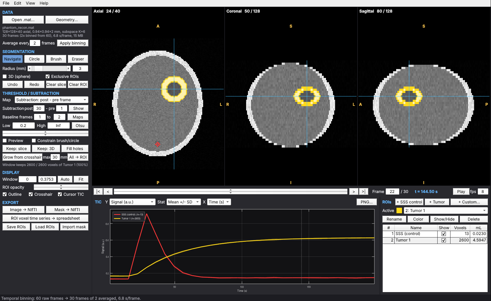
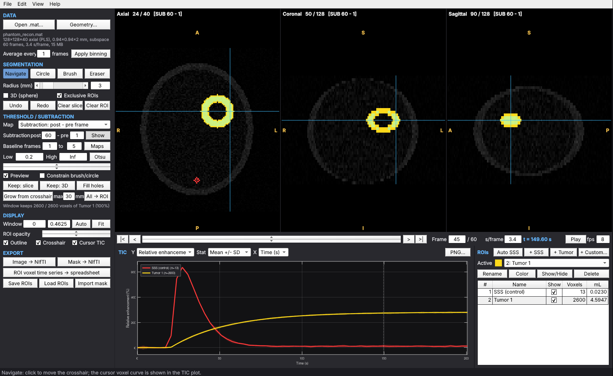
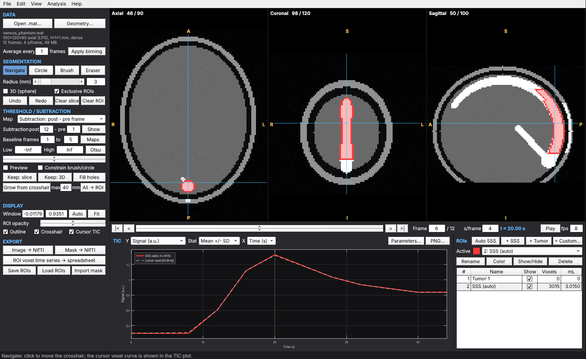
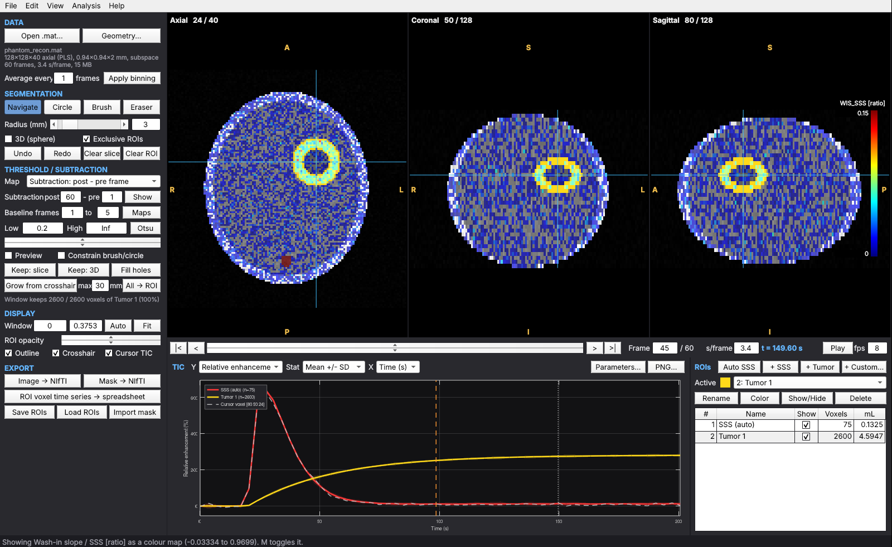
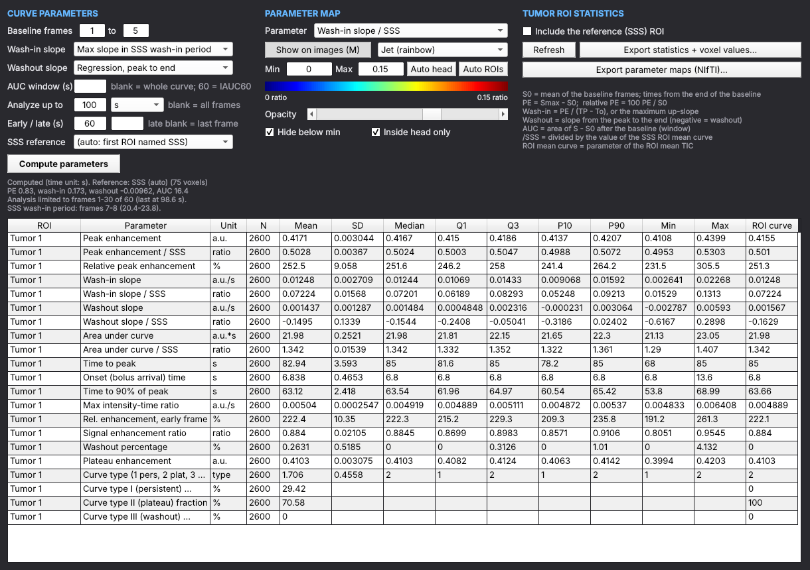
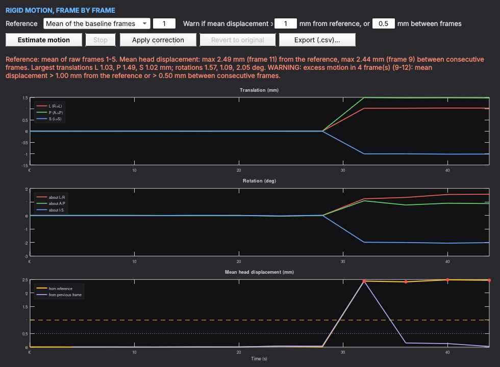

# GRASPilot (MATLAB)

3-plane viewer and ROI analysis platform for dynamic GRASP DCE-MRI: reconstructions
stored as MATLAB `.mat` files (deep learning subspace recon: `vk_all` + `basis_all`),
4D NIfTI files and DICOM series.

- No toolboxes required (own NIfTI and DICOM readers, own drawing tools). MATLAB R2019b or
  newer recommended; `.xlsx` export needs R2019a+ (`writecell`/`writematrix`), `.csv` works anywhere.
- Runs fully offline. Nothing is written except the files you export.













*Synthetic phantoms, rendered with GNU Octave; controls look slightly different in MATLAB.
Top: frame view after 2x temporal binning with the SSS control and the tumor ROI. Middle:
subtraction map (frame 60 - frame 1), threshold preview in green and the enhancing rim grown
from the crosshair (necrotic core excluded). Third: Auto SSS on a venous phantom - the ROI
(red) follows the posterior SSS from just above the torcula toward the vertex (sagittal
view); the straight sinus (anterior to it on the axial view), the transverse sinuses and a
scalp vein are excluded. Next:
wash-in slope / SSS as a jet colour map with the ROI outlines (analysis limited to the first
100 s, orange line on the curves), and the Parameters window with the tumor ROI statistics.
Last: Motion window for a phantom whose head moves 1-1.5 mm and 1.5-2 deg from frame 9 on
(warning in red, flagged frames as red dots).*

## Quick start

```matlab
addpath('/path/to/GRASPilot')
GRASPilot                               % then File > Open .mat (or the Open button)
GRASPilot('recon.mat')             % opens the load dialog for this file
GRASPilot(vk_all, basis_all)       % variables already in the workspace
GRASPilot(data1)                   % output of ReadData.m ([nx ny t nz])
GRASPilot('recon.mat', 'Voxel', [1 1 1], 'dt', 3.3, 'NoDialog', true)
GRASPilot('recon.mat', 'BinSize', 2)   % average every 2 frames on load
GRASPilot('dce_4d.nii.gz')             % 4D NIfTI
GRASPilot('/path/to/dicom_folder')     % DICOM series (or one of its image files)
```

The load dialog lists the variables in the file, detects `vk_all`/`basis_all`, shows the
resulting matrix/K/T and a memory estimate, and asks for the acquisition geometry: voxel
orientation (default LPS, see below), pixel spacing, slice spacing and temporal resolution.
The geometry is remembered between sessions and can be changed later under View > Geometry.

## NIfTI and DICOM input

File > **Open** also takes a 4D NIfTI (`.nii`, `.nii.gz`), several 3D NIfTI files (one per
frame, multi-select, sorted by name) or one image of a DICOM series; File > **Open DICOM
folder** scans a folder and its subfolders. For these inputs there is no load dialog:

- **Geometry from the header.** Voxel size, position and orientation come from the NIfTI
  affine or the DICOM image position/orientation. The images are shown in the same
  radiological layout as `.mat` data (axis codes are derived from the header; oblique
  slices are shown on their own grid, not resampled). Everything exported (images, masks,
  parameter maps) carries the scanner coordinates of the input, so the files overlay on the
  original series in ITK-SNAP, 3D Slicer, FSLeyes etc.
- **Frame timing.** DICOM: from the acquisition, trigger or content times of the frames
  (median interval). NIfTI: from a JSON sidecar written by GRASPilot, else `pixdim[4]` if it
  is a plausible frame time (0.5-600 s; shorter values are usually the sequence TR). When
  the header gives no frame time the status bar says so: enter s/frame in the time strip.
- **Signal.** Values are kept as stored (rescale slope/intercept applied), not normalized.
- **DICOM series.** If the folder holds several series a list appears (description, slices
  x frames, matrix); pick the dynamic series, or several series when every time frame was
  stored as its own 3D series. Frames are ordered by temporal position, acquisition time,
  trigger time, acquisition number, content time or instance number (the first that
  separates the frames of every slice; the status bar reports which).
- **Supported DICOM.** Classic (one file per slice and frame) and enhanced multi-frame MR
  images, uncompressed transfer syntaxes. Compressed images (JPEG, JPEG 2000, RLE) need
  `dicomread` from the Image Processing Toolbox; without it, convert first (e.g. with
  dcm2niix to NIfTI) and open the NIfTI. No patient-identifying elements are read.

Scripting:

```matlab
D = GRASPilotData.fromNifti('dce_4d.nii.gz');              % or {'f001.nii', 'f002.nii', ...}, 'dt', 3.3
scan = graspilot_dicom_read(folder, 'ScanOnly', true);     % scan.Series(k).Label
D = GRASPilotData.fromDicom(scan, 'Series', 2);
[V, info] = graspilot_dicom_read(folder);                  % array [nx ny nz T] + affine, dt
D = GRASPilotData.fromVolume(V, affine, 'dt', 3.3);        % any 4D array with a voxel -> RAS affine
```

## How frames are computed (identical to ReadData.m)

For slice z and frame t:

    data1(:,:,t,z) = abs( reshape(vk_all(z,:,:,:), nx*ny, K) * Phi_z' )     Phi_z = basis_all(z,:,:) as [T x K]

i.e. the `TempPCASub` adjoint (`PCA' * Recon`), followed by the `CropImg` central crop
(factor 2, removes the 2x readout oversampling) and division by the global maximum over
all slices and frames (taken before the crop, as in ReadData.m). The viewer keeps only
the cropped coefficients and synthesizes frames, slices, voxel time courses and maps on
demand. A ~2 GB file therefore needs roughly 0.5 GB after loading (peak ~2.5 GB while
reading), and the uncropped 4D array that ReadData.m builds is never created.

`tests/graspilot_validate_readdata('recon.mat')` re-runs the original ReadData.m arithmetic
with your `@TempPCASub` class on a real file and reports the difference (expected
~1e-7, single-precision rounding). Basis arrays stored as `[slices K T]` or a single
shared `[T K]` basis are also accepted.

## Orientation

The stored array `data1(:,:,t,z)` has rows, columns and slices (partitions). Its orientation
is described by three **axis codes**: the anatomical direction in which the row, column and
slice index increases (L/R, P/A, S/I), as in NIfTI.

| Code | Rows | Columns | Slices | Use |
|---|---|---|---|---|
| **LPS** (default) | R -> L | A -> P | I -> S | scanner x, y, z order; the deep-learning GRASP reconstructions are stored this way: `imagesc(data1(:,:,t,z))` shows the axial slice with anterior on the **left** |
| PLS | A -> P | R -> L | I -> S | arrays that `imagesc` already shows radiologically |
| ILP | S -> I | R -> L | A -> P | coronal slices |
| IPL | S -> I | A -> P | R -> L | sagittal slices |

Earlier versions assumed PLS, which showed the GRASP brains rotated 90 degrees (anterior to
the left on the axial view) with coronal and sagittal anatomy swapped between the two
reformat panels. LPS is now the default for new files.

**Left-right cannot be judged from symmetric anatomy.** LPS follows from the anterior-left,
superior-up appearance of the stored data (scanner axis order); confirm left-right once per
reconstruction pipeline with a lateralized finding (lesion side in the report) or a marker.
If it is mirrored, press Flip L-R.

View > Geometry shows the three codes as menus, preset buttons (LPS, PLS, ILP, IPL) and
**Rotate axial 90 CW**, **Flip L-R / A-P / S-I** buttons that apply immediately. The
setting is remembered for the next files, stored in ROI sessions and in the NIfTI JSON
sidecar. ROIs follow orientation changes. After loading, a quick check warns in the status
bar if the head looks wider left-right than front-back (view probably rotated 90 degrees).

## Coordinates

All exports use one canonical voxel order: i = Right->Left, j = Anterior->Posterior,
k = Inferior->Superior (LPS), with a NIfTI sform/qform that maps voxels to RAS mm with the
volume centred at 0. Image, mask and map NIfTIs therefore overlay in ITK-SNAP, 3D Slicer,
FSLeyes, nibabel etc. The geometry is approximate (voxel sizes and orientation from the
dialog, not scanner coordinates); masks are meant to be used with the image NIfTI exported
from this tool.

## Window layout

- Left: data info, segmentation tools, threshold, display, export.
- Top: axial / coronal / sagittal views with crosshair and orientation labels.
- Middle strip: frame slider (1-frame steps), first/prev/next/last buttons, typed frame
  number, temporal resolution (s/frame), time of the frame, play/pause with fps.
- Bottom: time-intensity curves (all visible ROIs overlaid) and the ROI manager.

Mouse: left = active tool, right-drag = window/level, shift- or middle-drag = pan,
wheel = slice, Ctrl+wheel = zoom, click on the TIC plot = jump to that frame.
Keys: Left/Right = frame -/+1 (Shift: 10), Home/End, PgUp/PgDn, Up/Down = slice,
Space = play, N/C/B/E = tools, [ ] = brush radius, D = 3D toggle, P = threshold preview,
S = subtraction view, G = grow from crosshair, M = parameter colour map on/off,
Ctrl+Z / Ctrl+Y = undo / redo. Help > Mouse and keyboard lists everything.

## Segmentation tools

- Navigate: click/drag moves the crosshair; the crosshair voxel's curve is shown dashed in
  the TIC plot (Cursor TIC), useful for locating the superior sagittal sinus.
- Circle: press at the centre, drag to the radius (radius shown in mm, anisotropic voxels
  handled). With 3D on it fills a sphere.
- Brush / Eraser: radius in mm; 2D (disk in the plane of the view) or 3D (sphere).
- Exclusive ROIs (default on): painting removes the voxels from other ROIs, so the label
  map has no overlap.
- Undo / redo: 100 steps, stored as voxel diffs (Ctrl+Z, Ctrl+Y).
- Multiple ROIs: `Auto SSS` (below), `+ SSS` (empty SSS control ROI to draw by hand),
  `+ Tumor` (auto-numbered Tumor 1..n), `+ Custom`. Rename, recolor, show/hide, delete;
  the table shows voxels and mL.
- Clear slice / Clear ROI, Fill holes (slice by slice in the plane of the last-used view).

## Automatic superior sagittal sinus ROI (Auto SSS)

**Auto SSS** (ROI panel, or Edit > Detect superior sagittal sinus) places the control ROI
`SSS (auto)` in the posterior superior sagittal sinus, from its thickest part just above the
torcula up along the sinus toward the vertex, excluding the transverse sinuses and the
straight sinus. Requires correct
orientation (LPS etc., see Orientation).

1. Peak enhancement map (maximum over time minus baseline) and a head mask (Otsu on the
   baseline image).
2. Venous structure: voxels enhancing >= 35% of the brightest voxel near the posterior
   midline; the largest 3D connected region grown from the brightest posterior-midline
   voxels (the SSS-torcula-transverse sinus complex; arteries and scalp veins form small
   separate regions).
3. Torcula level: the most superior axial slice where this structure is wider than 30 mm
   left-right (transverse sinuses leaving the midline).
4. On slices 5-40 mm above the torcula where the structure stays within 20 mm of width
   (midline SSS only), the SSS cross-section is its most posterior part against the
   occipital inner table, no deeper front-to-back than it is wide (excludes the straight
   sinus, which joins from anterior). The thickest cross-section (3-slice average) is chosen.
5. ROI: from 2 mm below the thickest slice up to 50 mm above it, following the sinus slice
   by slice. It stops earlier where the sinus cross-section is lost, wider than 20 mm or
   not continuous with the slice below, or where the sinus turns forward over the vertex
   (posterior edge moving forward by more than 1 mm per mm of height: axial cuts become
   oblique and partial-volumed). In each slice, the cross-section voxels enhancing >= 50%
   of their maximum (partial-volume edges excluded).

The crosshair moves to the ROI and the status bar reports the torcula slice, ROI slices,
extent, voxels, volume and why the ROI ends where it does. Running it again replaces `SSS (auto)`; Undo removes it; the eraser and
brush can edit it. If the transverse sinuses are not in the slab, the lowest posterior SSS
segment is used and the status bar says so. Always check the ROI on the three views.
Scripting: `[lin, info] = graspilot_detect_sss(D)` (options for every threshold in `help
graspilot_detect_sss`; e.g. `'SuperiorMM', 30` for a shorter ROI, `'SlabMM', 5` for the former
5 mm slab at the thickest slice).

## Enhancing tumor from the subtraction map

The subtraction map is `frame(post) - frame(pre)`, by default **last GRASP volume minus
first GRASP volume** (post = last, pre = first; both editable). It is the default threshold
map, and **Show** (or key S) displays it in all three views instead of the current frame,
with its own window/level.

1. `+ Tumor`, Map = *Subtraction: post - pre frame*, press **Show**.
2. Set the window: type Low (High = Inf), drag the slider, or draw a rough sphere around the
   lesion and press **Otsu**. Tick **Preview** to see in-window voxels in green.
3. Turn the subtracted enhancement into the ROI mask, either:
   - **Grow from crosshair** (key G): put the crosshair on the enhancing rim (Navigate) and
     add the 3D, 6-connected region of in-window voxels touching it, up to *max* mm from the
     crosshair. Vessels, choroid plexus and dura that do not touch the lesion stay out, and a
     non-enhancing necrotic core is excluded.
   - **Keep: 3D / Keep: slice**: draw a generous circle/sphere first, then keep only its
     in-window voxels.
   - **All -> ROI**: add every in-window voxel in the volume (includes vessels; erase or
     intersect afterwards).
4. Undo/redo, eraser and Fill holes work as usual on the result.

## Threshold maps

1. Signal at current frame
2. Subtraction: post - pre frame (default last - first)
3. Current frame - baseline
4. Current frame relative enhancement (%)
5. Peak - baseline (maximum after the baseline frames)
6. Peak relative enhancement (%)

Baseline = mean of the chosen pre-contrast frames (default 1-5). Maps 3-6 are computed on
first use (one pass over the data, a few seconds). Every map works with Preview, Otsu,
Keep: slice/3D, Grow from crosshair, All -> ROI and "Constrain brush/circle" (painting only
adds in-window voxels). The line under the buttons shows how many voxels of the active ROI
the current window keeps.

## Temporal resolution ("time unknown")

The temporal resolution is the time per reconstructed frame in seconds (spokes per frame x
TR). It is not stored in the `.mat` file, so it is unknown until you enter it; the viewer
then shows "(time unknown)" / "s/frame unknown" and plots curves against frame number.
Everything else (frames, maps, ROIs, exports) works without it.

Enter it in any of: the **s/frame** box in the frame strip (next to the frame number), the
load dialog, or View > Geometry. It is remembered for the next files. With it set, the
frame strip shows the time of the current frame, the TIC X axis can show seconds, time to
peak is exported in seconds and the NIfTI/JSON/spreadsheet exports carry frame times.
Enter the resolution of the original frames; after binning the viewer multiplies it by n.

## Temporal binning

Binning lowers the temporal resolution by averaging the signal intensity (magnitude) of n
consecutive reconstructed frames into one frame, e.g. to compare an 8-spoke reconstruction
binned x2 or x4 with the 16- and 32-spoke reconstructions of the same scan.

How to:

1. Open the reconstruction and (optionally) enter the s/frame of the original frames.
2. In the DATA section type n in **Average every [n] frames** (e.g. 2).
3. Press **Apply binning** (or Enter in the box). The status bar reports the result, e.g.
   `131 raw frames -> 65 frames of 2 averaged, 6.8 s/frame. Raw frame 131 dropped`.
4. Work as usual: views, slider, curves, enhancement maps and the subtraction map
   (last and first binned frames) all use the binned series. The current frame and the
   baseline frames are moved to the same time points.
5. Export. Image NIfTI: n x dt in pixdim(4), frame times and bin layout in the JSON sidecar.
   Spreadsheet: the file name gets the frame count, e.g.
   `case_roi_timeseries_65frames.xlsx` (CSV: `..._65frames_voxels.csv`), and the Info sheet
   records the bin size and dropped frames.
6. To return to the original series, set n = 1 and press Apply binning.

Details: frame i of the binned series is the mean of raw frames (i-1)n+1 ... in, and its
time is the mean of their times (bin centre). If the number of frames is not a multiple
of n, the incomplete last bin is dropped (reported); View > Temporal binning can keep it as
a shorter last bin instead. ROIs are not affected (they are spatial). Batch:
`graspilot_convert_mat2nifti(file, '', 'BinSize', n)`; scripting: `D.setBinning(n)`.
Binning averages reconstructed magnitude frames; it is not a reconstruction with more
spokes per frame.

## Time-intensity curves

Mean +/- SD band, median [IQR] band, or mean only; Y as signal, relative enhancement
(%), S/S0 or S-S0 (S0 = mean of the ROI curve over the baseline frames); X in seconds
(if temporal resolution is set) or frames. File > Save TIC plot as PNG.

## Semi-quantitative parameters (wash-in, washout, AUC, peak enhancement)

Analysis > Semi-quantitative parameters (or the **Parameters...** button above the curves) opens the
parameter window. Press **Compute parameters** (one pass over the data, a few seconds); the
voxel maps, the colour map and the statistics are then available. Voxel values and ROI
values are computed from the same time-intensity curve S(t) on the current (binned)
series.

Definitions (S0 = mean of the baseline frames; times are measured from the last baseline
frame, i.e. the injection; seconds if s/frame is set, otherwise frames):

| Parameter | Definition | Unit |
|---|---|---|
| Peak enhancement (PE) | Smax - S0, Smax = maximum after the baseline | a.u. |
| Relative peak enhancement | 100 x (Smax - S0) / S0 | % |
| Wash-in slope (WIS) | PE / (TP - To): line from the onset To to the peak TP (Khalifa 2014). Option: maximum up-slope between consecutive frames before the peak | a.u./s |
| Washout slope (WOS) | least-squares slope from the peak to the last frame (at least the last 3 frames, so a curve still rising at the end gets a positive slope). Option: 2-point (S_last - Smax)/(t_last - TP). Negative = washout | a.u./s |
| Area under the curve (AUC) | trapezoidal area of S - S0 from the end of the baseline to the end, or over the first N s (AUC window 60 = IAUC60, 90 = IAUC90) | a.u. x s |
| Time to peak (TTP) | TP measured from the end of the baseline | s |
| Onset (bolus arrival) time | To measured from the end of the baseline | s |
| Time to 90% of peak (T90) | first time the enhancement reaches 0.9 PE (interpolated between frames) | s |
| Maximum intensity-time ratio (MITR) | PE / TTP | a.u./s |
| Relative enhancement, early frame | 100 x (S_early - S0) / S0 at the early frame (default 60 s after the baseline) | % |
| Signal enhancement ratio (SER) | (S_early - S0) / (S_late - S0); late frame = last analysed frame unless set. > 1 = washout | ratio |
| Washout percentage | 100 x (Smax - S_last) / Smax, S_last = last analysed frame | % |
| Plateau enhancement | mean S - S0 of the last 3 analysed frames | a.u. |
| Curve type | 1 persistent, 2 plateau, 3 washout: change from the early to the late frame, 100 x (S_late - S_early)/S_early, above +10%, within +/-10%, below -10% | type |

Onset To = last frame before the peak whose enhancement is below 10% of PE. The early and
late frames are the frames nearest to the entered times after the baseline. For the curve
type the table also gives the percentage of ROI voxels of each type (the mean of the type
number is not meaningful) and, under ROI curve, the type of the ROI mean curve.

**Analysis endpoint.** "Analyze up to" limits every parameter to the first N seconds (from
the time of frame 1) or the first N frames, e.g. the first 100 s; later frames are ignored
(peak, slopes, AUC, late frame, plateau). The endpoint is marked by an orange dashed line
on the curves and recorded in the exports. Images, curves and the time-series export still
contain all frames.

**Wash-in in the SSS wash-in period.** With "Max slope in SSS wash-in period" the wash-in
period is defined on the SSS reference curve as its period of most rapid signal increase
(Lee, Berger et al., Neurosurgery 2023;92:497): the consecutive frames around the steepest
frame-to-frame rise of the SSS mean curve in which the slope stays at least 50% of the
steepest (`RefSlopeFrac`). The wash-in slope of a voxel or ROI curve is its maximum
frame-to-frame slope inside that period, so tissue and SSS slopes (and their ratio,
wash-in / SSS) come from the same time window. The period is shown in the window and in
the Settings sheet and is updated when the SSS ROI changes (then press Compute again).
The paper states the definition of the period but not the slope formula, so the 50% rule
and the maximum-slope rule are this tool's reading of it; set `RefSlopeFrac` to 1 to use
only the single steepest SSS interval.

**Normalization to the SSS.** "/SSS" parameters are the voxel value divided by the same
parameter of the reference ROI mean curve, in line with the AUC ratio to a venous/vascular
reference used for subtle blood-brain barrier leakage (Heye et al. 2016). The reference is
the first ROI whose name contains "SSS" (Auto SSS creates "SSS (auto)"), or the ROI chosen
under SSS reference. Normalization cancels the arbitrary scaling of the reconstruction
(global-maximum normalization, coil and receiver gain) and makes values comparable between
scans and between the 8/16/32-spoke reconstructions of one scan. The washout ratio is a
ratio of slopes: the SSS normally washes out (negative slope), so a positive WOS/SSS means
a tumor washout, a negative one a persistent rise.

**Colour maps.** Choose the parameter, Show on images (or key M), colour map (Jet or Turbo
rainbow, Hot, Gray), Min/Max (type values, Auto head = 1st-99.5th percentile in the head,
Auto ROIs = 2nd-98th percentile in the tumor ROIs), opacity, Hide below min and Inside head
only. The colour bar appears in the sagittal panel; the status bar shows the value under
the cursor. ROIs are drawn as outlines while a map is shown.

**Statistics.** The table lists, for every tumor ROI (all ROIs except the reference; tick
Include the reference to add it) and every parameter: N voxels, mean, SD, median, Q1, Q3,
10th and 90th percentile, min, max (voxel values; NaN voxels are ignored) and the
parameter of the ROI mean curve ("ROI curve"). Voxel-wise statistics describe
heterogeneity; the ROI-curve value is less noisy.

**Export.** Export statistics + voxel values writes `.xlsx` (sheet Stats, sheet Settings
with the definitions, options and the reference values, one sheet per ROI with one row
per voxel: Voxel, i, j, k, x_mm, y_mm, z_mm and one column per parameter) or `.csv`
(`_param_stats.csv`, `_param_voxels.csv`, `_param_settings.txt`); after binning the file
name ends in `_<N>frames`. Export parameter maps -> NIfTI (Parameters window, File
or Analysis menu) lists the maps to choose from and writes one NIfTI per map
(`<base>_PE.nii.gz`, `<base>_PE_SSS.nii.gz`, ...) in the geometry of the image export; with
NIfTI or DICOM input that is the scanner geometry of the source images.
ROI sessions (Save ROIs) keep the parameter options and the reference ROI.

Scripting:

```matlab
app.computeParams('WashIn', 'onset', 'WashOut', 'regression', 'AUCWindow', 60);
app.computeParams('WashIn', 'sss', 'EndTime', 100);     % SSS wash-in period, first 100 s
app.computeParams('EndTime', Inf, 'EndFrame', 100);     % or the first 100 frames
[hdr, rows] = app.paramStatsTable();       % cell table as shown in the window
app.setParamKey('WIS_SSS'); app.setParamDisplay(true); app.setParamCLim([0 2]);
app.exportParams('tumor_parameters.xlsx');
P = graspilot_curve_params(TC, D.paramTimes(), 1:5);   % any curves [N x T]
```

The parameter maps take about 50 MB of memory each for a 12-million-voxel volume (13 maps).

## Motion check and correction

Analysis > **Motion check and correction** opens the Motion window.

**Estimate motion** registers every reconstructed frame (raw frames, before binning) to a
reference volume with a rigid transform (3 translations, 3 rotations about the head
centre). The reference is the mean of the baseline frames (or a chosen frame). The cost is
normalized mutual information (Studholme et al. 1999), which tolerates the signal changes
from contrast enhancement; the search is a 2-level (3 mm, then 1 mm smoothing) simplex
optimization on up to 30,000 voxels of the head and its outline, each frame starting from
the previous estimate. It takes about 1-3 s per frame (Stop keeps the frames done). The
window plots translations (mm, along L, P, S), rotations (deg) and the mean displacement of
the head voxels, from the reference and from the previous frame.

**Warning.** Excess motion is reported (status bar, a message box, red text in the window
and MOTION WARNING in the data panel) when the mean head displacement of any frame exceeds
the thresholds: by default one voxel (geometric mean of the voxel size, at least 1 mm)
from the reference, or half a voxel between consecutive frames (sudden motion). The
flagged frames are listed and marked.

**Apply correction** resamples every frame at its estimated position (trilinear
interpolation; frames that moved less than 0.05 voxel are copied unchanged). The frames
then line up with the reference, so the ROIs (drawn on any frame) stay in place, and
images, curves, maps, parameters and exports all use the corrected frames. The corrected
series is held in memory as a full 4D array (the size is shown before applying; the
original data are kept for **Revert to original**). Estimating again on corrected frames
shows the residual motion. ROI sessions remember the correction and re-apply it when
loaded with the same data; the NIfTI JSON sidecar, the time-series Info sheet and the
parameter Settings sheet record whether it was applied. **Export (.csv)** writes the
parameters and displacements per frame.

Limits: motion during the acquisition also enters the subspace (low-rank) reconstruction
itself; realigning frames cannot remove the resulting blurring or ghosting, so frames
flagged as excess motion deserve a look even after correction. Only rigid motion is
modelled (no brain deformation or through-slab motion outside the imaged slab: frames are
padded with edge values there).

Scripting:

```matlab
M = app.estimateMotion();          % viewer: warns on excess motion
app.applyMotion();                 % realign; app.revertMotion() to undo
M = graspilot_motion_estimate(D, 'RefFrames', 1:5, 'WarnAbsMM', 1.5);
D.applyMotionCorrection(M);        % data model only
graspilot_convert_mat2nifti('recon.mat', '', 'dt', 3.3, 'MotionCorrect', true);  % batch, + _motion.csv
```

## Exports

| Button / menu | Output |
|---|---|
| Image -> NIfTI | 4D float32 `.nii.gz`/`.nii` (all frames, streamed frame by frame) or the current frame (3D), plus a JSON sidecar (frame times, source, geometry, normalization) |
| Mask -> NIfTI | uint8 label map (value = ROI number), `<name>_labels.txt` (label, name, RGB, voxels, mL), `<name>_itksnap_labels.txt`; optionally one binary mask per ROI |
| ROI voxel time series -> spreadsheet | `.xlsx`: sheets Info, Summary (per-ROI mean, SD, median, relative enhancement, n per frame) and one sheet per ROI with one row per voxel: Voxel, i, j, k, x_mm, y_mm, z_mm, F001..Fnnn. `.csv`: `_voxels.csv` (all ROIs, ROI_ID/ROI_Name columns), `_summary.csv`, `_info.txt`. After binning the file name ends in `_<N>frames` |
| File or Analysis > Export parameter maps -> NIfTI (also in the Parameters window) | choose the maps in a list (baseline, maximum and every parameter; PE, WIS, WOS, AUC also /SSS); one float32 `<base>_<key>.nii.gz` per map in the geometry of the image export. Scripting: `app.exportMaps(folder, base, {'PE', 'WIS_SSS'})` |
| Parameters > Export statistics + voxel values | parameter statistics per tumor ROI and voxel values (see above) |
| (binning) | binned series everywhere; JSON sidecar and Info sheet record bin size, raw frames per frame and dropped frames |
| Save / Load ROIs | `.mat` session (ROI names, colors, voxels in native indices, geometry); reloads onto any reconstruction with the same matrix, e.g. the 8-, 16- and 32-spoke versions of one scan |
| Import mask | label NIfTI from this tool or edited elsewhere; axis permutations/flips are corrected from the header; names/colors are read from `_labels.txt` if present |

When a new file with the same matrix size is opened, the viewer offers to keep the
current ROIs, so the same ROIs can be applied across reconstructions.

i, j, k in the spreadsheet are 1-based indices into the exported NIfTI arrays (as returned
by `niftiread` in MATLAB); x, y, z are RAS mm from the affine. Excel limits (1,048,575
voxels per ROI, 16,384 columns) apply to `.xlsx`; use `.csv` for very large ROIs.

## Scripting and batch use

```matlab
% batch conversion of every reconstruction in a folder to 4D NIfTI
f = dir('*.mat');
for k = 1:numel(f)
    graspilot_convert_mat2nifti(f(k).name, '', 'Voxel', [1 1 1], 'dt', 3.3);   % AxisCodes 'LPS' by default
end
graspilot_convert_mat2nifti('recon_8spoke.mat', '', 'dt', 1.6, 'BinSize', 2);   % binned x2
graspilot_convert_mat2nifti('recon.mat', '', 'dt', 3.3, 'MotionCheck', true);     % warn only

% data model only
D = GRASPilotData.fromFile('recon.mat');
D.setAxisCodes('LPS'); D.VoxNative = [1 1 1]; D.dt = 3.3;
D.setBinning(2);                   % optional: average frame pairs
V  = D.canonVolume(40);            % 3D frame 40 (canonical order)
S  = D.canonSubtraction(D.NT, 1);  % last - first
TC = D.timecourses(find(mask));    % voxel x frame matrix for a canonical mask
graspilot_export_timeseries(D, {mask}, {'Tumor 1'}, 'tumor.csv', 'BaseFrames', 1:5);
[sss, info] = graspilot_detect_sss(D);  % automatic SSS ROI (canonical indices)

% drive the GUI
app = GRASPilot(D);
app.setFrame(45); app.addTumor();
app.setThrSource('sub'); app.setThreshold(0.2, Inf);
app.setPos([90 50 24]); app.growFromCrosshair();
app.autoSSS();
app.exportMaskNifti('mask.nii.gz');
```

Standalone build (MATLAB Compiler): `mcc -m graspilot_app.m -a GRASPilot.m -a GRASPilotData.m -a graspilot_*.m`.

## Files

| File | Purpose |
|---|---|
| `GRASPilot.m` | GUI (classic figure, no toolboxes) |
| `GRASPilotData.m` | data model: subspace/dense loading, frame synthesis, orientation, maps, affine |
| `graspilot_load_dialog.m` | variable/format/geometry dialog |
| `graspilot_dicom_read.m` | DICOM series -> 4D array, affine, frame timing (no toolbox) |
| `graspilot_nifti_write.m`, `graspilot_nifti_read.m` | NIfTI-1 I/O (.nii/.nii.gz), streaming 4D writes |
| `graspilot_write_dce_nifti.m` | series -> NIfTI + JSON sidecar |
| `graspilot_export_timeseries.m` | voxel time series -> .xlsx/.csv |
| `graspilot_curve_params.m` | semi-quantitative curve parameters (vectorized over curves) |
| `graspilot_ref_window.m`, `graspilot_end_frame.m` | SSS wash-in period; analysis endpoint |
| `graspilot_motion_estimate.m` | rigid frame-by-frame motion (normalized mutual information) and excess-motion check |
| `graspilot_rigid_matrix.m`, `graspilot_motion_summary.m` | rotation matrix; motion summary text |
| `graspilot_export_params.m` | parameter statistics and voxel values -> .xlsx/.csv |
| `graspilot_reorient_to_ref.m` | mask import reorientation |
| `graspilot_detect_sss.m` | automatic superior sagittal sinus ROI |
| `graspilot_convert_mat2nifti.m` | batch .mat -> NIfTI |
| `graspilot_app.m` | launcher / compiler entry point |
| `docs/` | README screenshots |
| `legacy/` | the original ReadData.m, CropImg.m and @TempPCASub (reference for validation) |
| `tests/graspilot_selftest.m` | synthetic end-to-end test (`graspilot_selftest(true)` also drives the GUI) |
| `tests/graspilot_validate_readdata.m` | compares the viewer with ReadData.m on a real file |
| `tests/graspilot_sss_phantom.m` | venous phantom (SSS, torcula, transverse/straight sinuses, scalp vein, artery) |
| `tests/graspilot_motion_phantom.m` | the venous phantom with known rigid motion of chosen frames |

## Notes and limitations

- For `.mat` input the geometry comes from the dialog: voxel sizes, orientation (especially
  left-right) and frame timing should be checked once per protocol. NIfTI and DICOM input
  take them from the header.
- The DICOM reader was validated on synthetic series (pixels, geometry and timing against
  pydicom-written files and dcm2niix), not yet on scanner exports; check orientation and the
  frame count/order on the first real series. Siemens mosaics and colour images are not
  supported.
- Auto SSS was tested on synthetic phantoms; check its ROI on real data, in particular
  near the torcula and with a hypoplastic or asymmetric confluence.
- Motion estimation was validated on a phantom with known motion (2-3 mm, 2-3 deg recovered
  to < 0.1 mm mean error); on real GRASP frames check the plots for implausible jumps
  (e.g. in noisy early frames) before applying the correction.
- Signal is the magnitude of the reconstruction (normalized to the global maximum when
  ReadData.m normalization is on); no T1 mapping or concentration conversion is done.
  Parameters are therefore semi-quantitative (signal-based): compare absolute values only
  between scans with the same protocol and scaling, or use the /SSS values.
- Voxel-wise slopes are noisy at high temporal resolution; binning or the ROI-curve values
  are more robust.
- Fill holes is 2D (slice by slice). Grow from crosshair is the connected-component tool
  (6-connectivity, bounded by the max distance).
- Binning averages magnitudes of reconstructed frames; it does not re-reconstruct with
  more spokes per frame.
