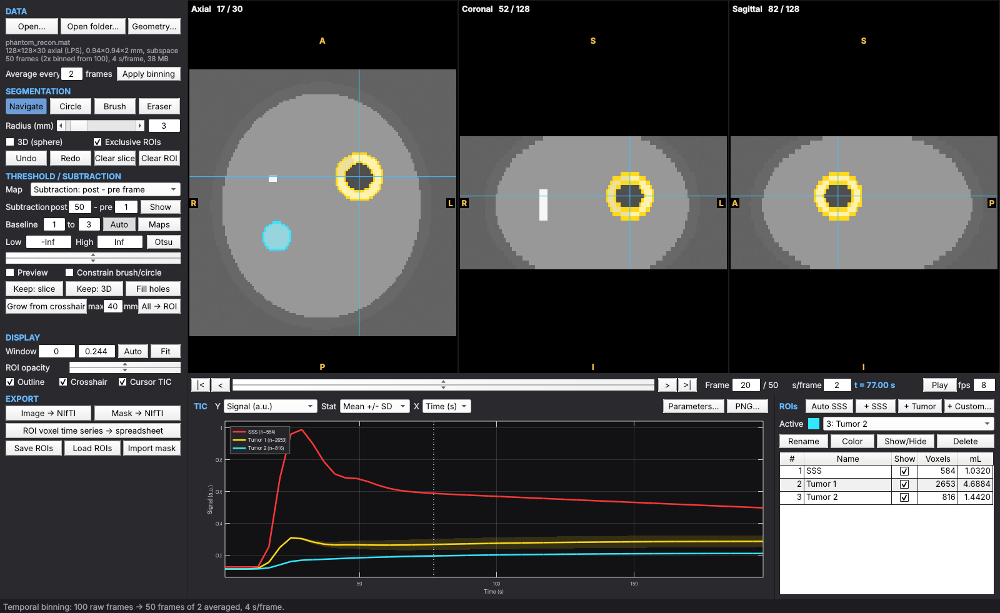
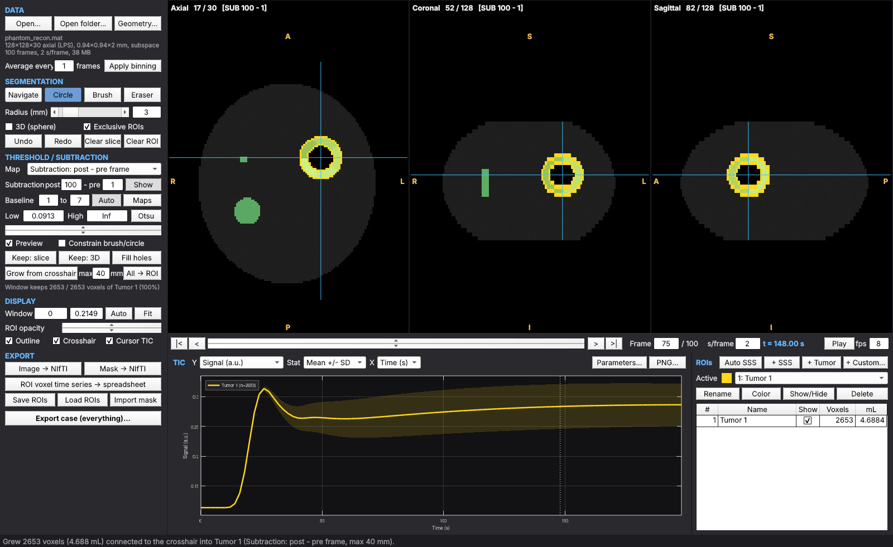
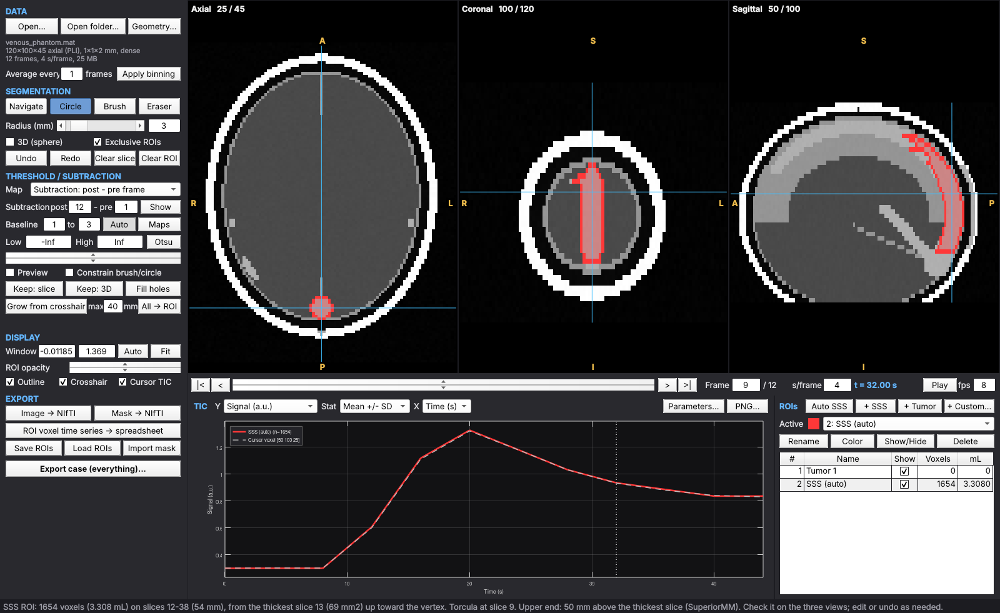
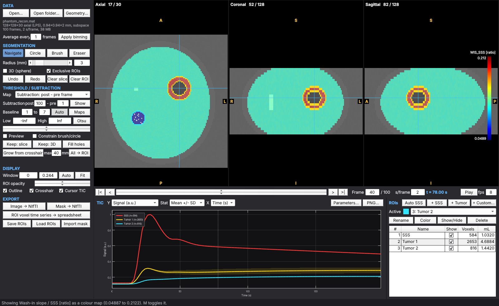
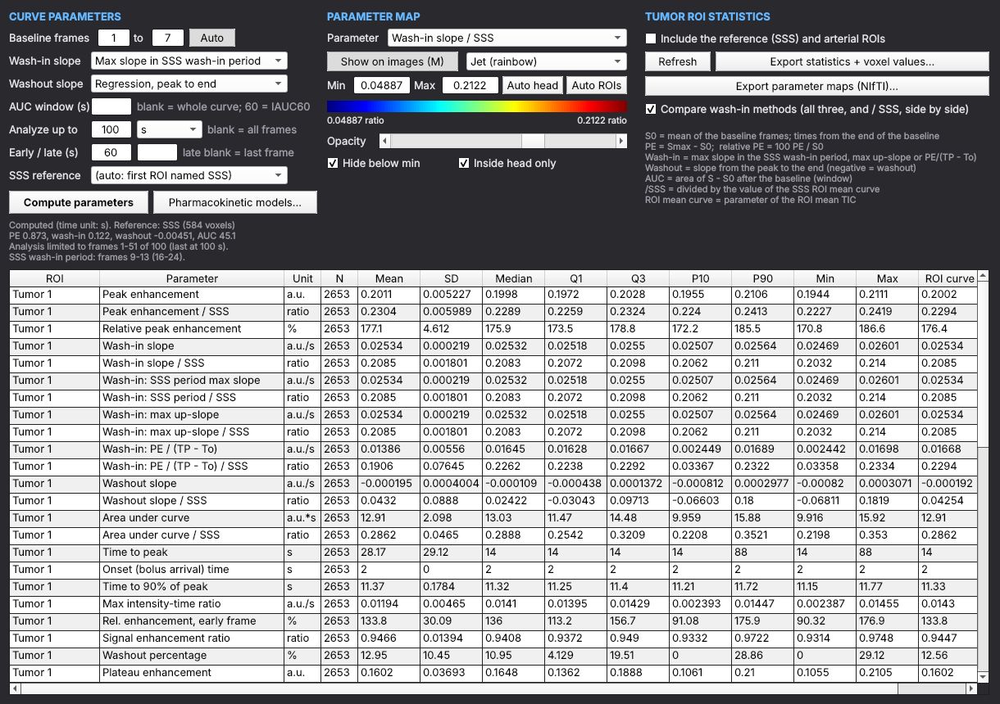
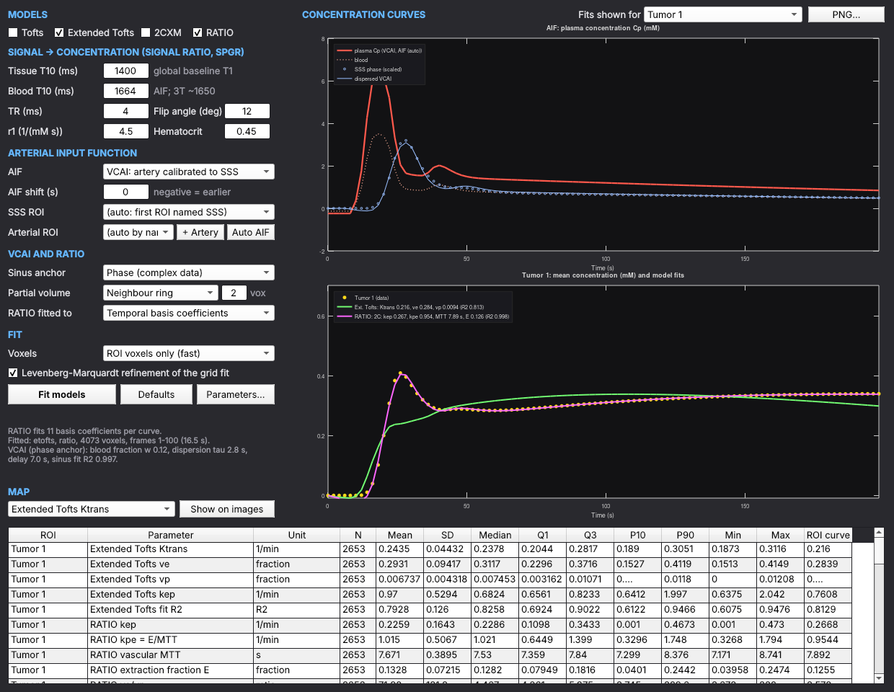
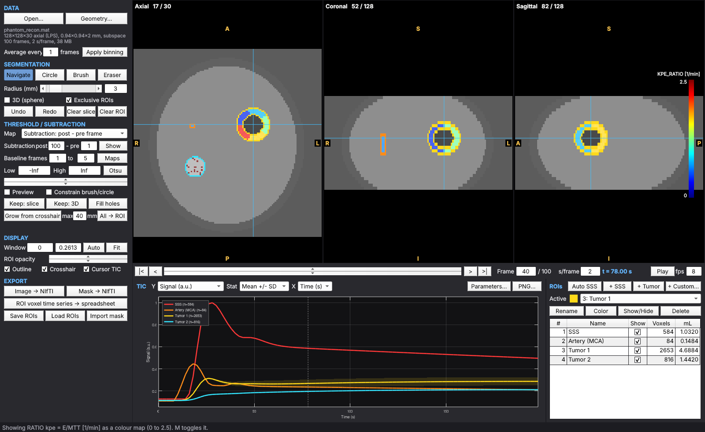
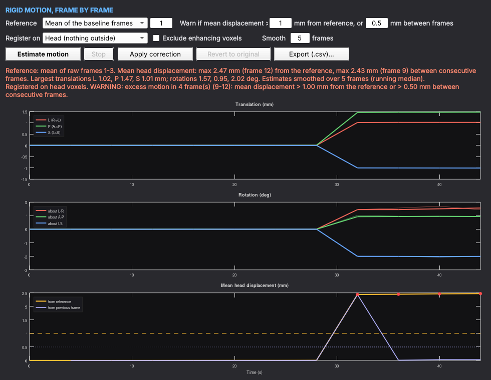

# GRASPilot (MATLAB)

3-plane viewer and ROI analysis platform for dynamic GRASP DCE-MRI: subspace
reconstructions in MATLAB `.mat` files (`vk_all` + `basis_all`), 4D NIfTI and DICOM series.
Segmentation, time-intensity curves, semi-quantitative parameters, pharmacokinetic models
(Tofts, extended Tofts, 2CXM, RATIO), motion correction and NIfTI/spreadsheet exports.

- No toolboxes required (own NIfTI and DICOM readers, own drawing tools). MATLAB R2019b or
  newer recommended; `.xlsx` export needs R2019a+, `.csv` works anywhere.
- Runs offline; nothing is written except the files you export.



*Frame view after 2x temporal binning with the SSS control and tumor ROIs. All screenshots
show synthetic phantoms rendered with GNU Octave; controls look slightly different in MATLAB.*

## Quick start

```matlab
addpath('/path/to/GRASPilot')
GRASPilot                              % then Open... or Open folder...
GRASPilot('recon.mat')                 % load dialog for this file
GRASPilot(vk_all, basis_all)           % variables in the workspace
GRASPilot(data1)                       % output of ReadData.m ([nx ny t nz])
GRASPilot('recon.mat', 'Voxel', [1 1 1], 'dt', 3.3, 'NoDialog', true)
GRASPilot('recon.mat', 'BinSize', 2)   % average every 2 frames on load
GRASPilot('dce_4d.nii.gz')             % 4D NIfTI
GRASPilot('/path/to/folder')           % DICOM series (also extensionless files), NIfTI or .mat
GRASPilot('/path/to/dicom/IM_0001')    % one image of a DICOM series
```

For `.mat` files the load dialog detects `vk_all`/`basis_all`, shows matrix, K, T and a
memory estimate, and asks for orientation (default LPS), voxel size and s/frame. These are
remembered and can be changed under View > Geometry.

## Input

**`.mat` subspace reconstructions** are synthesized exactly as in ReadData.m:

    data1(:,:,t,z) = abs( reshape(vk_all(z,:,:,:), nx*ny, K) * Phi_z' ),   Phi_z = basis_all(z,:,:) as [T x K]

followed by the `CropImg` central crop (factor 2) and division by the global maximum. Only
the cropped coefficients are kept; frames, time courses and maps are computed on demand (a
~2 GB file needs ~0.5 GB). `tests/graspilot_validate_readdata('recon.mat')` compares with
the original ReadData.m on a real file (expected difference ~1e-7). Bases stored as
`[slices K T]` or one shared `[T K]` are accepted.

**Open folder...** (button or File menu) opens what a folder holds: a DICOM series, NIfTI
files (one 4D file, or 3D files = frames in name order) or a `.mat` file; a list asks when
there is a choice. DICOM files are recognized by their content, so names without an
extension (e.g. `IM_0001`, `I1234`) and files without the 128-byte preamble work, and
subfolders (patient/study/series) are searched. Other files in the folder are ignored.

**NIfTI and DICOM** need no dialog:

- Geometry from the header; exports keep the scanner coordinates of the input, so they
  overlay on the original series. Oblique slices are shown on their own grid.
- Frame times: DICOM acquisition (or trigger) times; uneven spacing (> 5% from the median)
  keeps the measured time of every frame for curves and parameters. NIfTI: GRASPilot JSON
  sidecar, else `pixdim[4]` if plausible (0.5-600 s). Otherwise enter s/frame.
- Values as stored (rescale slope/intercept applied), not normalized.
- A folder with several series shows a list with the likely dynamic series preselected.
  Series with the same grid are joined as consecutive frames (by acquisition time, else
  series number), which covers one-series-per-frame exports.
- Classic and enhanced multi-frame MR, uncompressed. Compressed images need `dicomread`
  (Image Processing Toolbox), or convert with dcm2niix first. No patient-identifying
  elements are read.

```matlab
D = GRASPilotData.fromNifti('dce_4d.nii.gz');           % or {'f001.nii', ...}, 'dt', 3.3
scan = graspilot_dicom_read(folder, 'ScanOnly', true);  % scan.Series(k).Label
D = GRASPilotData.fromDicom(scan, 'Series', 2);
D = GRASPilotData.fromVolume(V, affine, 'dt', 3.3);     % any 4D array + voxel -> RAS affine
```

## Orientation and coordinates

Three **axis codes** give the direction in which row, column and slice index increase:

| Code | Rows | Columns | Slices | Use |
|---|---|---|---|---|
| **LPS** (default) | R -> L | A -> P | I -> S | scanner order; GRASP reconstructions (`imagesc(data1(:,:,t,z))` shows anterior on the left) |
| PLS | A -> P | R -> L | I -> S | arrays `imagesc` already shows radiologically |
| ILP / IPL | S -> I | R -> L / A -> P | A -> P / R -> L | coronal / sagittal slices |

**Left-right cannot be judged from symmetric anatomy**: confirm it once per reconstruction
pipeline with a lateralized finding, and press Flip L-R if mirrored. View > Geometry has
the codes, presets, Rotate axial 90 CW and Flip L-R/A-P/S-I; ROIs follow. A check after
loading warns if the head looks wider than long (view probably rotated).

Exports use one voxel order (i = R->L, j = A->P, k = I->S) with an affine to RAS mm, so
image, mask and map NIfTIs overlay in ITK-SNAP, 3D Slicer, FSLeyes and nibabel. For `.mat`
input the affine is centred at 0 (geometry from the dialog).

## Window, mouse and keys

Left: data, segmentation, threshold, display, export. Top: axial/coronal/sagittal views.
Middle: frame slider, s/frame, time, play. Bottom: time-intensity curves and ROI manager.

Mouse: left = tool, right-drag = window/level, shift/middle-drag = pan, wheel = slice,
Ctrl+wheel = zoom, click on the curves = jump to that frame. Keys: Left/Right frame
(Shift: 10), Up/Down slice, Space play, N/C/B/E tools, [ ] brush size, D 3D, P preview,
S subtraction view, G grow, M parameter map, X crosshair, Ctrl+Z/Y undo/redo (Help lists all).

## Segmentation

- **Tools:** Navigate (the crosshair voxel's curve is shown dashed), Circle (sphere in 3D),
  Brush/Eraser (radius in mm, 2D or 3D). Exclusive ROIs (default) prevent overlap. 100 undo
  steps. Clear slice/ROI, Fill holes (2D).
- **ROIs:** Auto SSS, + SSS, + Tumor (numbered), + Custom; rename, recolor, hide, delete;
  voxels and mL listed.
- **Threshold maps:** signal at the frame, subtraction post - pre (default), frame -
  baseline, relative enhancement, peak - baseline, peak relative enhancement (baseline =
  mean of the baseline frames, detected automatically, see below). Each works with Preview, Otsu, Keep:
  slice/3D, Grow, All -> ROI and Constrain brush/circle.

### Enhancing tumor from the subtraction map



*Subtraction map (frame 60 - frame 1), threshold preview in green and the enhancing rim
grown from the crosshair, necrotic core excluded.*

1. + Tumor, Map = *Subtraction: post - pre frame* (default last - first), **Show** (key S).
2. Set the window: type Low, drag the slider, or draw a rough sphere and press **Otsu**;
   **Preview** shows in-window voxels in green.
3. **Grow from crosshair** (G): adds the 6-connected in-window region touching the
   crosshair, up to *max* mm away, so vessels and the necrotic core stay out. Or **Keep:
   3D/slice** inside a drawn sphere/circle, or **All -> ROI**.

### Automatic superior sagittal sinus ROI (Auto SSS)



*Auto SSS on a venous phantom: the ROI (red) follows the posterior SSS from above the
torcula toward the vertex; straight and transverse sinuses and a scalp vein are excluded.*

**Auto SSS** places `SSS (auto)` in the posterior SSS. It works in a 25 mm band along the
head surface, where the sinuses lie (the straight sinus, deep vessels and most tumors do
not), on voxels enhancing >= 50% of the brightest posterior-midline voxel there (the
moderately enhancing dura and falx drop out). The torcula is the top of the lowest run of
slices where the posterior structure is wider than 30 mm (transverse sinuses), so cortical
veins joining the SSS higher up do not move it. Above it, the ROI takes the most posterior
midline cross-section against the inner table, from 2 mm below the thickest one up to
50 mm. It stops where the sinus is lost, jumps or turns forward over the vertex. Veins
joining the sinus and partial-volume edges (< 50% of the maximum) are trimmed. The status
bar explains the result; always check the ROI. It needs the correct orientation and voxel
size (a wrong slice spacing shortens the ROI).

If detection fails, put the crosshair on the sinus above the torcula and accept *Use
crosshair*, or use Edit > **SSS ROI from crosshair** at any time. The crosshair voxel must
wash out after the first pass like venous blood, so a crosshair on tumor or dura is
rejected. Scripting: `[lin, info] = graspilot_detect_sss(D)` or `app.autoSSS('Seed',
[i j k])` (thresholds in `help graspilot_detect_sss`).

## Time, binning and curves

**s/frame** (frame strip, load dialog or View > Geometry) is not stored in `.mat` files;
without it curves are plotted against frames and everything else still works.

**Temporal binning** (*Average every n frames* + **Apply binning**) averages the magnitudes
of n consecutive frames, e.g. to compare an 8-spoke reconstruction binned x2/x4 with the
16-/32-spoke ones. Views, curves, maps and exports then use the binned series; an
incomplete last bin is dropped unless kept (View > Temporal binning); n = 1 restores the
original. Exports record the bin size and add `_<N>frames` to file names. It is not a
reconstruction with more spokes per frame.

**Baseline frames** (S0 for every map, parameter, curve and PK model) are detected
automatically by default (**Auto** next to the baseline fields, also in the Parameters
window). The bolus arrival is found on the mean curve of the earliest-arriving tenth of the
strongly enhancing voxels (arteries enhance before veins and tissue), by fitting a
constant-then-linear-rise model up to the peak. The baseline is frame 1 up to the arrival,
minus trailing frames already 3% of the rise above baseline (temporal smoothing of the
reconstruction). It is re-detected after binning or motion correction. Without a clear bolus,
frames 1-5 are used. Typing frames switches Auto off; ROI sessions keep the choice.
Scripting: `[bf, info] = D.detectBaseline()`, `app.setAutoBaseline(true)`.

**Curves:** mean +/- SD, median [IQR] or mean only; signal, relative enhancement, S/S0 or
S - S0; seconds or frames. File > Save TIC plot as PNG.

## Semi-quantitative parameters



*Wash-in slope / SSS as a colour map with ROI outlines; analysis limited to the first 100 s
(orange line).*

Analysis > Semi-quantitative parameters (or **Parameters...** above the curves) >
**Compute parameters**. S0 = mean of the baseline frames; times from the last baseline
frame (injection); seconds if s/frame is set, else frames.

| Parameter | Definition | Unit |
|---|---|---|
| Peak enhancement (PE) | Smax - S0 (maximum after the baseline) | a.u. |
| Relative peak enhancement | 100 PE / S0 | % |
| Wash-in slope (WIS) | PE / (TP - To), onset To to peak TP (Khalifa 2014); options: maximum up-slope, or maximum slope in the SSS wash-in period | a.u./s |
| Washout slope (WOS) | least-squares slope from the peak to the end (at least 3 frames); option: 2 points. Negative = washout | a.u./s |
| AUC | area of S - S0 after the baseline, whole curve or first N s (IAUC60, IAUC90) | a.u. x s |
| TTP, onset, T90 | time to peak, to onset (last frame < 10% of PE), to 90% of PE | s |
| MITR | PE / TTP | a.u./s |
| Early relative enhancement | 100 (S_early - S0) / S0, early frame 60 s after the baseline | % |
| SER | (S_early - S0) / (S_late - S0); late = last analysed frame unless set | ratio |
| Washout percentage | 100 (Smax - S_last) / Smax | % |
| Plateau | mean S - S0 of the last 3 analysed frames | a.u. |
| Curve type | 1 persistent, 2 plateau, 3 washout: early -> late change > +10%, within, < -10% | type |

- **Analysis endpoint** ("Analyze up to"): only the first N s or frames are used for every
  parameter; marked by an orange line.
- **SSS wash-in period** (Lee, Berger et al., Neurosurgery 2023;92:497): the frames around
  the steepest rise of the SSS curve where its slope stays >= 50% of the steepest
  (`RefSlopeFrac`); the wash-in slope is the maximum slope in that period. The 50% and
  maximum-slope rules are this tool's reading of the paper.
- **/SSS** values divide by the same parameter of the reference ROI mean curve (first ROI
  named SSS, or chosen), cancelling the arbitrary scaling of the reconstruction (cf. the
  venous AUC ratio of Heye et al. 2016). A positive WOS/SSS means tumor washout.



*Parameters window: settings, colour map and statistics per tumor ROI (here including the
pharmacokinetic parameters).*

**Colour maps:** parameter, Show on images (M), Jet/Turbo/Hot/Gray, Min/Max (Auto head =
1st-99.5th percentile in the head, Auto ROIs = 2nd-98th in the tumor ROIs), opacity, Hide
below min, Inside head only. The status bar shows the value under the cursor.

**Statistics** per tumor ROI (all ROIs except the reference SSS and the arterial ROI, unless
included): N, mean, SD, median, quartiles, 10th/90th percentile, min, max of the voxel
values, and the value of the ROI mean curve (less noisy). For curve types and RATIO classes
the share of voxels per class is listed.

**Export:** statistics + voxel values to `.xlsx` (sheets Stats, Settings, one per ROI with
i, j, k, x, y, z and one column per parameter) or `.csv`; parameter maps to one NIfTI per
map (`<base>_<key>.nii.gz`). ROI sessions keep the options and the reference ROI.

```matlab
app.computeParams('WashIn', 'sss', 'AUCWindow', 60, 'EndTime', 100);
[hdr, rows] = app.paramStatsTable();
app.setParamKey('WIS_SSS'); app.setParamDisplay(true); app.setParamCLim([0 2]);
app.exportParams('tumor_parameters.xlsx');
P = graspilot_curve_params(TC, D.paramTimes(), 1:5);   % any curves [N x T]
```

## Pharmacokinetic models



*Pharmacokinetic models window. Top: VCAI arterial input (red) with the SSS phase curve and
the dispersed VCAI it was calibrated against (blue). Bottom: tumor ROI concentration with
the extended Tofts fit (green, cannot follow the vascular transit peak) and the RATIO
two-compartment fit (magenta).*

Analysis > **Pharmacokinetic models** (or the button in the Parameters window). Tick the
models, check the settings and the curves, press **Fit models**. The maps join the parameter
list (colour map, statistics with the ROI-curve fit, exports).

| Model | Maps (key) |
|---|---|
| Standard Tofts | Ktrans (`KT_TM`, 1/min), ve (`VE_TM`), kep (`KEP_TM`, 1/min), R2 (`R2_TM`) |
| Extended Tofts | Ktrans, ve, vp, kep, R2 (`KT_ETM`, `VE_ETM`, `VP_ETM`, `KEP_ETM`, `R2_ETM`) |
| 2CXM | Fp and PS (ml/100 ml/min), vp, ve, Ktrans = E Fp, R2 (`FP_2CXM`, `PS_2CXM`, `VP_2CXM`, `VE_2CXM`, `KT_2CXM`, `R2_2CXM`) |
| RATIO | kep, kpe, MTT, E, ve/vp, class, leakage call, apparent vp/Ktrans/Fp/ve (below) |

**Signal to concentration (signal ratio, global T10).** No T1 map: S/S0 removes M0, coil
and reconstruction scaling, and the spoiled gradient echo equation gives R1:

    A = (S/S0)(1 - E10)/(1 - cos(a) E10),  E10 = exp(-TR/T10),  E1 = (1 - A)/(1 - A cos(a))
    C = (-ln(E1)/TR - 1/T10) / r1

One **tissue T10** for all voxels (default 1400 ms) and a **blood T10** for the AIF
(1664 ms, 3 T). TR (4 ms), flip angle (12 deg), r1 (4.5 /mM/s) and Hct (0.45) are
placeholders: **enter your protocol and agent** (r1 in plasma at 3 T: gadobutrol ~5.0,
gadoterate ~3.5, gadopentetate ~3.7; Rohrer 2005). Ktrans scales with the assumed T10, so
keep it fixed across scans. Baseline frames must be strictly pre-contrast.

**AIF.** *Reference ROI (SSS)*: large, little partial volume, but venous (late, broadened);
**AIF shift** moves it in time. *Population* (Parker 2006), injection at the last baseline
frame. *VCAI*: arterial ROI calibrated to the SSS (below). Plasma = blood / (1 - Hct).

**Fitting.** Frames up to the analysis endpoint; uneven frame times supported; exact
convolution for an AIF linear between frames. Rate constants on a log grid with the linear
parameters solved exactly (variable projection), then Levenberg-Marquardt. Voxels inside
the head (default), ROI voxels only (fast) or all. On an SPGR phantom with 2% noise the
median maps are within 1% of the true Ktrans, ve, vp, Fp and PS. Octave speed: ~15,000
voxels/s (Tofts), ~4,000 (2CXM). Changing settings, baseline, endpoint, frame times or the
vessel ROIs hides the maps until the next fit. A pure Tofts-like curve also fits the 2CXM
as large vp with low PS: check R2 and the curves.

### RATIO and the VCAI



*RATIO kpe = E/MTT (fitted on ROI voxels): kpe varies around the ring-enhancing tumor;
the second lesion is mostly one-compartment slow (kep only, no kpe).*

**RATIO** (Rate-based, Amplitude-invariant, Transit-resolved kinetics with an Input anchored
to the venous Outflow; M. Lee, unpublished, 2026) is the two-compartment exchange model
refitted without a concentration scale. Every curve has a free gain G and delay d:

    2C:  y(t) = G [h(.; kF, E, rho) * u](t - d)      1C:  y(t) = G [k exp(-k .) * u](t - d)

kF = Fp/vp, E = PS/(Fp + PS), rho = kE/kF <= 0.5 (kE = PS/ve). G absorbs vp, T10, B1, r1
and the input amplitude. AICc picks 2C or 1C per curve:

| Class (`CLASS_RATIO`) | Condition | Reported |
|---|---|---|
| 1 two-compartment | AICc prefers 2C | kep = rho kF (1 - E) (`KEP_RATIO`), kpe = kF E = E/MTT (`KPE_RATIO`), MTT = 1/kF (`MTT_RATIO`, s), E (`E_RATIO`), ve/vp (`VEVP_RATIO`); leakage (`LEAK_RATIO`) if E >= 0.03 |
| 2 one-compartment fast | k >= 4 /min | MTT = 1/k; no leakage |
| 3 one-compartment slow | k <= 1.5 /min | kep = k |
| 4 indeterminate | 1.5 < k < 4 /min | k only (`K1_RATIO`); no leakage call |

kep and kpe are primary; MTT and E depend on the assumed transit shape. Apparent values
(exploratory, scale-dependent): vp = G, Ktrans = G kpe, Fp = G kF, ve = Ktrans/kep
(`VP_RATIO`, `KT_RATIO`, `FP_RATIO`, `VE_RATIO`); in 1C classes G is vp (fast) or ve (slow).
Also mapped: delay (`DELAY_RATIO`) and R2 (`R2_RATIO`).

**Temporal basis.** For subspace data RATIO fits, by default, the coefficients of each
voxel on an orthonormal real basis of its slice's (binned) reconstruction basis; AICc
counts coefficients as observations, so the 2C model needs >= 7 (rank rule) and curves fall
back to the 1C classes otherwise. A complex basis can give up to 2K coefficients; the
window shows the number. Other data are fitted on frames.

**VCAI** (AIF: *VCAI: artery calibrated to SSS*) fits the signal-weighted blood fraction w
of an arterial ROI, the venous dispersion tau and delay delta so that the dispersed arterial
curve matches the sinus curve up to a gain:

    A(t)/A0 = w Sb(ca(t))/Sb(0) + (1 - w) N(t)/N0,   phi(t) - phi0 ~ g [exp(-t/tau)/tau * ca](t - delta)

A: arterial ROI (**+ Artery**, or an ROI named artery/AIF/MCA/ICA; a few MCA or distal ICA
voxels). N: 2-voxel ring of neighbouring tissue (or *None*: static background). Sb: blood
SPGR signal (blood T10). phi: SSS phase from complex `.mat` data, else the SSS magnitude
converted with the blood T10 (less accurate). Check w, tau (about 3-8 s), delta and the
sinus-fit R2 shown in the window. The VCAI can also drive the other models.

On a complex phantom (artery with 30% blood volume, sinus dispersed 5 s and delayed 6 s)
the VCAI recovered w, tau, delta and the arterial curve exactly with either anchor; RATIO
classified 2C, slow and fast lesions correctly with kep, kpe, E and MTT within 5% (2 s
frames). RATIO is slow (~300 curves/s in Octave): fit ROI voxels. Not implemented: input
amplitude from the sinus phase, bootstrap calibration of the classes, complex-domain fits.

```matlab
app.autoSSS();
app.computePK('Models', {'tofts', 'etofts', '2cxm'}, 'T10', 1400, 'TR', 3.9, ...
    'FlipAngle', 12, 'r1', 5.0, 'AIF', 'ref', 'AIFShift', -2);
app.computePK('Models', {'ratio'}, 'AIF', 'vcai', 'VCAIAnchor', 'phase', 'Region', 'rois');
app.setParamKey('KPE_RATIO'); app.setParamDisplay(true);
app.exportMaps(folder, 'case01', {'KT_ETM', 'VP_ETM', 'KEP_RATIO', 'KPE_RATIO'});

C  = graspilot_signal2conc(S, S0, 1.4, 3.9e-3, 12, 5.0);       % s, s, deg, 1/(mM s)
R  = graspilot_pk_fit(C, t, Cp, {'tofts', 'etofts', '2cxm'});  % R.tofts.Ktrans, R.cxm.Fp
[ca, vi] = graspilot_vcai(A, N, sinusPhase, t, 1:5, struct('TR', 3.9e-3));
R  = graspilot_ratio_fit(C, t, ca / 0.55, struct('Basis', Q)); % R.kep, R.kpe, R.Class
Cb = graspilot_pop_aif(t - tInjection);                       % population AIF (blood, mM)
```

## Motion check and correction



*Phantom whose head moves 1-1.5 mm and 1.5-2 deg from frame 9 on: warning in red, flagged
frames as red dots.*

Analysis > **Motion check and correction**. **Estimate motion** registers every raw frame
rigidly to the mean of the baseline frames (or a chosen frame) with normalized mutual
information (robust to global enhancement); ~1-3 s per frame. A warning appears when the
mean head displacement exceeds one voxel from the reference or half a voxel between frames.

- **Register on:** *Head* (default) uses head voxels only. The streak artifacts of radial
  (stack-of-stars) sampling outside the head rotate from frame to frame and could be read
  as rotation. *Brain only* also leaves out the scalp; *Head + outline* is the former
  behaviour (head plus a 4 mm band outside it).
- **Exclude enhancing voxels:** leaves out vessels, scalp, dura and enhancing lesions.
  Asymmetric enhancement can be read as motion. An estimate that grows with the contrast
  uptake and then plateaus, with no visible motion, suggests this; re-estimate with the
  option and compare.
- **Smooth:** running median of the estimates over 5 frames (1 = none). It removes
  frame-to-frame estimation noise, which correction would otherwise add as jitter, and
  keeps sudden (step) motion. The plots show the smoothed estimates over the faint
  per-frame ones.

**Apply correction** resamples the frames trilinearly (held in memory as a 4D array;
**Revert** restores them), so ROIs, curves, maps and exports use aligned frames; sessions
and exports record it. Below the warning thresholds it asks first: sub-voxel corrections
mostly add interpolation blur. **Export (.csv)** writes the motion per frame. Only rigid
motion is corrected; motion blurring inside the reconstruction remains.

```matlab
M = app.estimateMotion(); app.applyMotion();       % app.revertMotion() to undo
M = graspilot_motion_estimate(D, 'RefFrames', 1:5, 'Region', 'brain', 'ExcludeEnhancing', true);
D.applyMotionCorrection(M);
graspilot_convert_mat2nifti('recon.mat', '', 'dt', 3.3, 'MotionCorrect', true);  % batch, + _motion.csv
```

## Exports

| Export | Output |
|---|---|
| Image -> NIfTI | 4D float32 (or current frame) + JSON sidecar (frame times, source, geometry, binning, motion) |
| Mask -> NIfTI | uint8 label map, `_labels.txt`, ITK-SNAP label file; optionally one mask per ROI |
| ROI voxel time series | `.xlsx` (Info, Summary, one sheet per ROI: i, j, k, x, y, z, F001..) or `.csv` |
| Parameter maps -> NIfTI | chosen maps, one float32 `<base>_<key>.nii.gz` each |
| Parameter statistics + voxel values | `.xlsx` or `.csv` (see Semi-quantitative parameters) |
| Save / Load ROIs | `.mat` session (ROIs, geometry, options); reloads onto any reconstruction with the same matrix, e.g. 8-/16-/32-spoke versions |
| Import mask | label NIfTI, reoriented from its header; names/colours from `_labels.txt` |

When a file with the same matrix is opened, the current ROIs can be kept. i, j, k are
1-based indices into the exported NIfTI arrays; x, y, z are RAS mm. Use `.csv` for ROIs
above Excel's limits.

## Scripting and batch use

```matlab
f = dir('*.mat');                                   % batch .mat -> 4D NIfTI
for k = 1:numel(f)
    graspilot_convert_mat2nifti(f(k).name, '', 'Voxel', [1 1 1], 'dt', 3.3);
end
graspilot_convert_mat2nifti('recon.mat', '', 'dt', 1.6, 'BinSize', 2, 'MotionCheck', true);

D = GRASPilotData.fromFile('recon.mat');            % data model only
D.setAxisCodes('LPS'); D.VoxNative = [1 1 1]; D.dt = 3.3; D.setBinning(2);
V  = D.canonVolume(40);  TC = D.timecourses(find(mask));
graspilot_export_timeseries(D, {mask}, {'Tumor 1'}, 'tumor.csv', 'BaseFrames', 1:5);

app = GRASPilot(D);                                 % drive the GUI
app.addTumor(); app.setThrSource('sub'); app.setThreshold(0.2, Inf);
app.setPos([90 50 24]); app.growFromCrosshair(); app.autoSSS();
app.exportMaskNifti('mask.nii.gz');
```

Standalone build: `mcc -m graspilot_app.m -a GRASPilot.m -a GRASPilotData.m -a graspilot_*.m`.

## Version and updates

Help > About shows the version: the latest GitHub release the code is based on (e.g.
`0.1.0`) and, when GRASPilot runs from a git checkout, the exact revision from `git describe`
(e.g. `v0.1.0-12-gab9e173` = 12 commits after release v0.1.0, `-dirty` = local changes).
Exports (JSON sidecar, spreadsheet Info/Settings sheets) and ROI sessions record the same
string. Help > GitHub page opens https://github.com/Beyond-Enhancement/GRASPilot (releases,
issues). In code: `graspilot_version()`. When tagging a release `vX.Y.Z`, set `Version` in
`graspilot_version.m` to `X.Y.Z`.

## Files

| File | Purpose |
|---|---|
| `GRASPilot.m`, `graspilot_app.m` | GUI; launcher / compiler entry point |
| `graspilot_version.m` | version, git revision and repository URL |
| `GRASPilotData.m` | data model: loading, frame synthesis, orientation, maps, PK maps, affine |
| `graspilot_load_dialog.m`, `graspilot_dicom_read.m` | `.mat` dialog; DICOM reader |
| `graspilot_folder_contents.m`, `graspilot_is_dicom.m` | what a folder holds; DICOM detection by content |
| `graspilot_nifti_read.m`, `graspilot_nifti_write.m`, `graspilot_write_dce_nifti.m` | NIfTI I/O, series + JSON sidecar |
| `graspilot_export_timeseries.m`, `graspilot_export_params.m` | spreadsheet exports |
| `graspilot_curve_params.m`, `graspilot_ref_window.m`, `graspilot_end_frame.m` | semi-quantitative parameters, SSS wash-in period, endpoint |
| `graspilot_signal2conc.m`, `graspilot_pop_aif.m`, `graspilot_pk_defaults.m` | signal -> concentration, population AIF, PK defaults |
| `graspilot_pk_fit.m`, `graspilot_ratio_fit.m`, `graspilot_vcai.m` | Tofts / extended Tofts / 2CXM; RATIO; VCAI |
| `graspilot_expconv.m`, `graspilot_varpro_lm.m` | exact exponential convolution; batched Levenberg-Marquardt |
| `graspilot_motion_estimate.m`, `graspilot_rigid_matrix.m`, `graspilot_motion_summary.m` | motion |
| `graspilot_detect_sss.m`, `graspilot_reorient_to_ref.m`, `graspilot_convert_mat2nifti.m` | Auto SSS; mask import; batch conversion |
| `legacy/` | original ReadData.m, CropImg.m, @TempPCASub (validation reference) |
| `tests/graspilot_selftest.m` | end-to-end test; `graspilot_selftest(true)` also drives the GUI |
| `tests/graspilot_validate_readdata.m` | compares with ReadData.m on a real file |
| `tests/*_phantom.m` | venous (SSS; `'realistic'`: cortical veins, dura, tumor, 2 mm, rotated), motion (optionally rotating streaks, brain texture, one-sided lesion), PK (SPGR) and RATIO (complex subspace) phantoms |

## Notes and limitations

- `.mat` geometry comes from the dialog: check voxel size, left-right and timing once per
  protocol.
- The DICOM reader, Auto SSS (incl. a phantom with cortical veins, enhancing dura and a
  tumor beside the sinus), motion estimation and the PK models were validated on
  synthetic data only; check them on the first real series.
- Signal is the reconstruction magnitude. Semi-quantitative values compare only between
  scans with the same protocol and scaling (or use /SSS). PK values depend on the assumed
  T10, TR, flip angle, r1 and the AIF; GRASP reconstruction can smooth the AIF first pass.
  RATIO rates do not depend on the concentration scale, but its thresholds (E >= 0.03,
  1.5-4 /min) come from simulation and are not calibrated on patient data.
- Voxel-wise slopes are noisy at high temporal resolution; binning or ROI-curve values are
  more robust.
